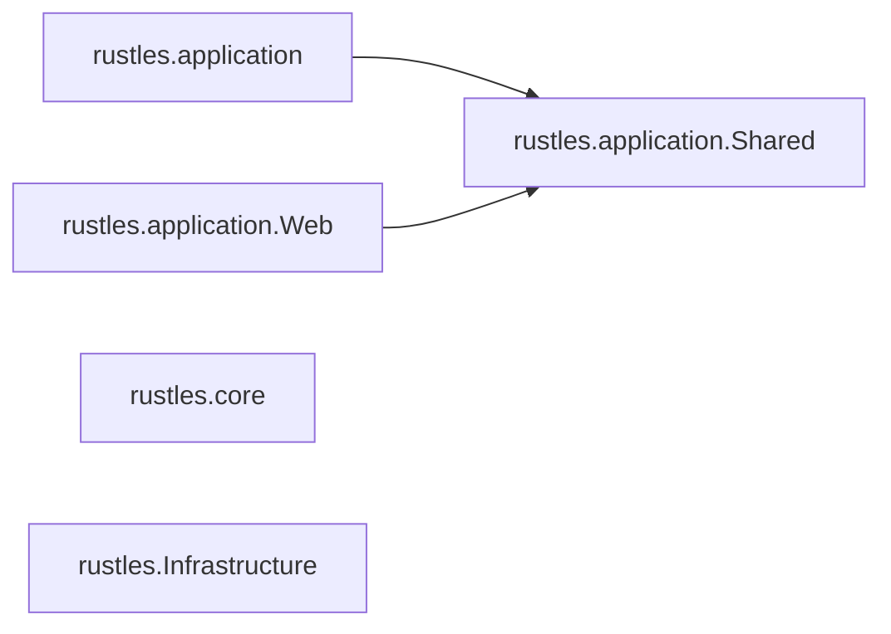

# Rustles Architecture Overview

This describes the repo as it exists today. It does not assume the intended integrations are finished.

## At a glance

Rustles is split into five .NET projects:

- `rustles.application`: a MAUI host for desktop and mobile.
- `rustles.application.Shared`: shared Blazor UI, routes, layout, and static assets.
- `rustles.application.Web`: an ASP.NET Core host for the shared UI.
- `rustles.core`: the real center of gravity today, holding domain models and the geospatial resolution pipeline.
- `rustles.Infrastructure`: an EF Core data layer with entity models and a `DbContext`.

## Current dependency map

The important detail is that the app hosts are not wired into `rustles.core` or `rustles.Infrastructure` yet. The solution is organized as if those connections will exist, but the compile-time references are still mostly separate.

## Intended shape

The code strongly suggests this flow:

1. A UI host accepts user input.
2. `rustles.core` resolves positions, rooms, and municipality data.
3. `rustles.Infrastructure` persists users, rooms, messages, and positions.
4. The UI renders the result back to the user.

That is a sensible layered direction. The repo just is not fully there yet.

## Current maturity

- The app layer is mostly template scaffolding.
- The core project contains the most domain-specific thinking.
- The infrastructure project is a starter persistence layer, not a finished one.
- Several classes, interfaces, and async paths are still placeholders.

## Bottom line

The architecture has a clear intended split between host, domain, and persistence. The current codebase is better described as an early architecture skeleton with one substantial prototype module inside `rustles.core`.
