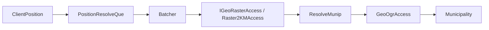

# rustles.core Architecture

## Responsibility

`rustles.core` is the domain and processing project. It contains the only clearly custom application logic in the repo today, especially around geospatial lookup and batched resolution work.

## Main parts

- `Entities/*` and `Entities/DTOs/*`: core data structures such as users, rooms, positions, municipalities, and action results.
- `Abstractions/*`: boundary interfaces, though several are still empty or unfinished.
- `Systems/GDAL/*`: GDAL and OGR-based lookup logic for raster and municipality data.
- `Systems/ResolutionQue/*`: batching and queue-style orchestration around position resolution.
- `Events/*`: lightweight event hooks for batch signalling.
- `Assets/*`: local geospatial source files used by the GDAL pipeline.

## Current internal shape

## Design notes

The project is trying to separate three concerns:

- domain data,
- geospatial adapters,
- orchestration for batched work.

That is a good direction. The problem is execution quality, not architectural intent.

## Current maturity

- This project builds successfully.
- It contains real domain-specific code and data assets.
- It also has clear prototype signals: placeholder classes, empty facades, `NotImplementedException` paths, and naming inconsistencies such as `Que`, `Resultion`, and `Munip`.
- Some interfaces read more like notes to self than settled contracts.

## Bottom line

This is the most important project in the repo and the least finished at the same time. The architecture has a useful backbone, but it still needs a cleanup pass before it feels like a stable application core.
