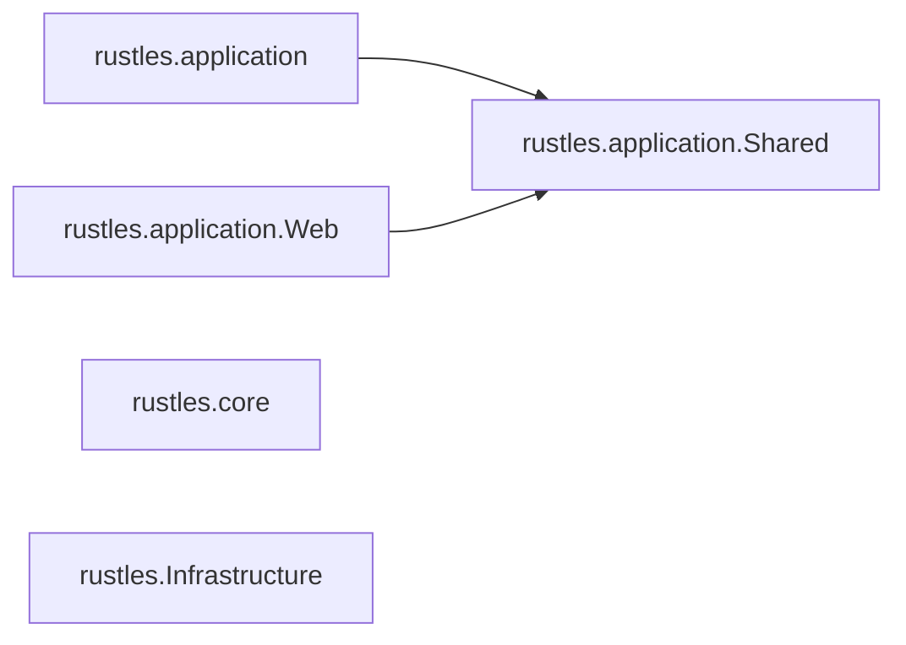

# Dependency Graph Tooling

## Current project graph

This is the current compile-time project graph, based on the project files:

Within the projects, the most meaningful dependency graph to draw is inside `rustles.core`, because that is where most of the real logic lives.

## What I would use

### Best serious option: NDepend

If you want one tool that can carry a .NET codebase for a long time, I would pick NDepend.

Why:

- it gives both dependency graphs and a dependency matrix,
- it is strong at cycle detection,
- it works at project, namespace, type, and method levels,
- it can turn architecture rules into checks instead of just pictures.

This is the best fit if you want architecture analysis to become part of the way you work, not just a one-off diagram.

### Best IDE-first option: JetBrains Rider

If you want a faster visual workflow, Rider is a strong option.

Why:

- it has built-in project dependency diagrams,
- it also has type dependency diagrams,
- it can export diagrams to Mermaid, Graphviz, PlantUML, and draw.io-friendly formats.

This is probably the nicest interactive option if you want to explore the code by hand.

### Best Microsoft-first option: Visual Studio architecture tools

If you want to stay inside Visual Studio, use code maps and dependency diagrams.

Why:

- they are native to the Microsoft stack,
- they are good for higher-level dependency and layer views,
- dependency diagrams can also be used as an architectural contract, not just a drawing.

This is the safest default if you want a Microsoft-owned workflow, but it is less flexible than Rider or NDepend for deep code exploration.

## My recommendation for Rustles

- If you want the best long-term architecture tool, use NDepend.
- If you want the best day-to-day exploration experience, use Rider.
- If you want the lightest adoption path because you already live in Visual Studio, start with code maps and dependency diagrams.

For this repo, I would start with Rider or Visual Studio for quick exploration, then move to NDepend once the project boundaries settle down.

## What to graph first

Start with these four graphs:

1. Solution project graph.
2. `rustles.core` namespace or folder graph.
3. `rustles.core` type graph around the GDAL and resolution queue pipeline.
4. `rustles.Infrastructure` entity and `DbContext` graph.

That sequence will give you a useful map without drowning you in detail.

## Sources

- [NDepend project dependency diagram](https://www.ndepend.com/docs/project-dependency-diagram)
- [NDepend class dependency diagram](https://www.ndepend.com/docs/class-dependency-diagram)
- [NDepend dependency structure matrix](https://www.ndepend.com/Docs/Dependency-Structure-Matrix-DSM)
- [JetBrains Rider visual dependency analysis](https://www.jetbrains.com/help/rider/Visual_Dependency_Analysis.html)
- [JetBrains Rider project dependency diagram](https://www.jetbrains.com/help/rider/Architecture__Project_Dependencies_Exploration.html)
- [JetBrains Rider type dependency diagram](https://www.jetbrains.com/help/rider/Exploring_Type_Dependency_Graph.html)
- [JetBrains Rider diagram export formats](https://www.jetbrains.com/help/rider/Creating_diagrams.html)
- [Visual Studio code maps](https://learn.microsoft.com/en-us/visualstudio/modeling/map-dependencies-across-your-solutions?view=vs-2022)
- [Visual Studio dependency diagrams](https://learn.microsoft.com/en-us/visualstudio/modeling/create-layer-diagrams-from-your-code?view=vs-2022)
