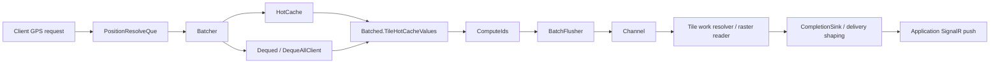
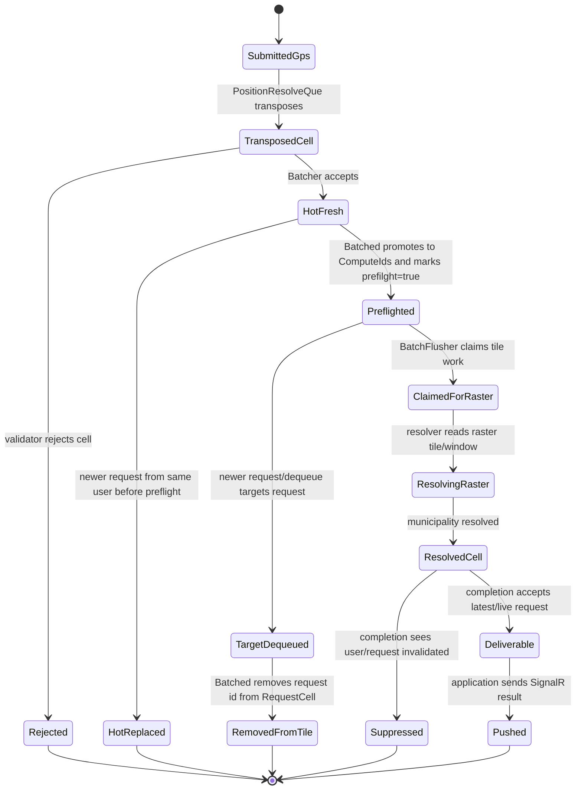
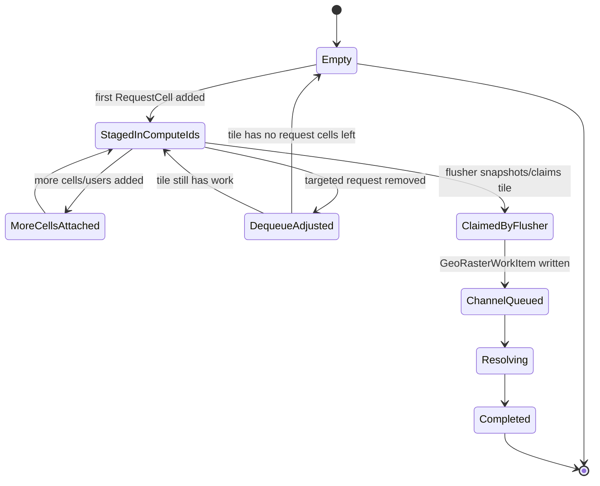
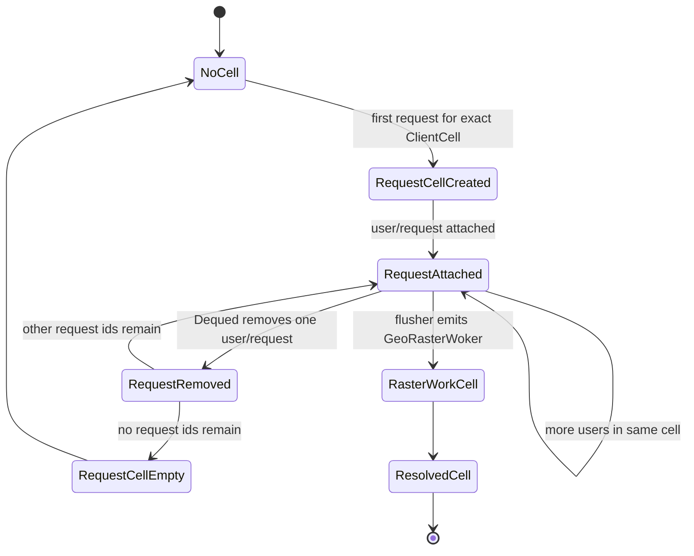

# Georesolution Responsibility and State Model

This note maps the current `rustles.core` georesolution rewrite by class responsibility, data ownership, and request state transitions.

The goal is not to describe the ideal final version. The goal is to make the current moving parts understandable enough that the next implementation steps can be reasoned about without holding the whole system in memory.

This note covers the code under [`rustles.core/Systems/ResolutionQue`](../rustles.core/Systems/ResolutionQue).

## Current High-Level Shape

The pipeline is split into staged ownership boundaries:



The important idea is that the request path does not directly read the raster and does not directly own tile execution.

Request threads should stay cheap. The expensive and stateful work is pushed into background-owned stages.

## Responsibility Summary

| Type | Current responsibility |
| --- | --- |
| `PositionResolveQue` | Ingress boundary. Transposes client GPS into raster cell coordinates, validates bounds, creates `BatchRequest`, forwards to `IBatcher`. |
| `BatchRequest` | Normalized request DTO after coordinate transpose. Carries `RequestId`, `ClientId`/user id, and raster-space `ClientCell`. |
| `IValidateTransposedCoordinates` | Validates that transposed raster cell coordinates are inside the supported raster shape. |
| `Batcher` | Cheap request-thread mutation layer. Applies latest-wins semantics through `HotCache`, records targeted invalidation in `Dequed`, and records disconnect invalidation in `DequeAllClient`. |
| `TileKey` | Coarse raster tile identity derived from raster-space cell coordinates by dividing by tile size `256`. |
| `ITileBatcher<TTileKey>` | Shared state contract for hot requests, compute-stage tile buckets, and invalidation structures. |
| `Batched` | Shared state owner and hotcache tiler. Owns `HotCache`, `ComputeIds`, `Dequed`, and `DequeAllClient`. Periodically moves hot requests toward tile-local compute buckets. |
| `TilingResult` | Summary/counter object for a hotcache tiling run. |
| `HotcacheValue` | Latest known request for a user plus `prefilght` marker. The source currently spells this field `prefilght`. |
| `DequeKey` | Targeted invalidation key for a request/cell pair. |
| `DequedValue` | Targeted invalidation payload. Carries tile, cell, request id, user id, and tile-local id. |
| `RequestCell` | Compute-stage cell bucket inside a tile. Holds one raster cell and all request/user ids attached to that cell. |
| `CellRequestId` | User/request correlation value attached to a `RequestCell`. |
| `ClientCell` | Raster-space integer cell coordinate. Used as the exact cell identity after transpose. |
| `IBatchFlusher` | Flush contract for claiming compute-ready tile work and writing it to the georaster work channel. |
| `BatchFlusher` | In-progress background service that snapshots `ComputeIds`, converts tile cells into `GeoRasterWorkItem`, and writes them into `Channel<GeoRasterWorkItem>`. |
| `GeoRasterWoker` | In-progress pre-read raster work payload. Current active shape in `IBatchFlusher` is one cell plus a list of `CellRequestId`s. |
| `GeoRasterWorkItem` | Claimed tile work item written to the resolver channel. Represents one tile plus the requested cells inside it. |
| `ITileWorkResolver` | In-progress resolver contract. Currently overlaps with `IBatchFlusher` concepts and should be treated as not settled. |
| `BulkDispatcher` | Older dispatcher shape. Currently still task-list/semaphore oriented and does not match the emerging channel pipeline. |
| `CompletionSink<TResult>` | Older caller-promise completion shape. Still based on `TaskCompletionSource`; does not yet match the new SignalR delivery/filter responsibility. |
| `WorkFactory<TResult>` | Legacy helper for creating promise-backed work items through `TaskCompletionSource`. Relevant to the old request-waiting model, not the target channel model. |
| `Tile<TWorkItem>` | Small container for grouped cells. Currently legacy/general-purpose compared with the newer `GeoRasterWorkItem`. |

## Current Data Structures

### `HotCache`

Type:

```csharp
ConcurrentDictionary<Guid, HotcacheValue>
```

Key:

- `UserId`

Value:

- `RequestId`
- `ClientCell`
- `prefilght`

Responsibility:

- keep the latest known request for a user
- keep request-thread mutation cheap
- act as staging before a request becomes tile-local compute work

Important behavior:

- if a user sends another request before the previous request is preflighted, `Batcher` can replace the hot value
- if a user sends another request after the previous request is preflighted, `Batcher` should target the previous request for invalidation through `Dequed`

### `ComputeIds`

Type:

```csharp
ConcurrentDictionary<TileKey, SortedDictionary<int, RequestCell>>
```

Key:

- `TileKey`

Value:

- sorted tile-local cells

Responsibility:

- hold compute-stage tile buckets
- group exact raster cells by parent tile
- attach multiple users/requests to the same cell

Important behavior:

- `Batched.TileHotCacheValues` writes into this structure
- `BatchFlusher` is starting to read from this structure and convert it into `GeoRasterWorkItem`
- this is staging state, not the final execution channel

### `Dequed`

Type:

```csharp
ConcurrentDictionary<DequeKey, DequedValue>
```

Responsibility:

- targeted invalidation for a request/cell pair
- used when a request may already have moved past pure hot state
- allows lazy removal from tile-local compute state

Current behavior:

- `Batcher` writes to it when an existing preflighted request is superseded
- `Batched.TileHotCacheValues` checks it and removes matching request ids from matching tile cells when it finds them

### `DequeAllClient`

Type:

```csharp
ConcurrentStack<Guid>
```

Responsibility:

- user-wide invalidation, mainly disconnect behavior
- avoid expensive immediate search/removal across all live tile structures

Current behavior:

- `Batcher.DeQue(userId)` pushes the user id
- `Batched.TileHotCacheValues` checks it while processing hotcache entries

## Request State Automaton

This is the current conceptual lifecycle of a single georesolution request.



### State Definitions

| State | Meaning |
| --- | --- |
| `SubmittedGps` | Raw client coordinates exist with a `requestId` and `userId`. |
| `TransposedCell` | Coordinates have been converted into raster-space `ClientCell`. |
| `Rejected` | The transposed cell is outside the raster or otherwise unresolvable. |
| `HotFresh` | The request is in `HotCache` and has not yet been promoted into tile-local compute state. |
| `HotReplaced` | A newer request for the same user replaced this request before preflight. |
| `Preflighted` | The request has been promoted into `ComputeIds` and the hotcache value is marked `prefilght=true`. |
| `TargetDequeued` | A targeted invalidation exists for this request/cell pair. |
| `RemovedFromTile` | The request id has been removed from the tile-local `RequestCell`. |
| `ClaimedForRaster` | A flusher has converted the tile/cell work into `GeoRasterWorkItem`. |
| `ResolvingRaster` | A resolver worker is reading the raster and resolving cell values. |
| `ResolvedCell` | A municipality result exists for the cell. |
| `Suppressed` | The result is not delivered because the user disconnected or the request became stale. |
| `Deliverable` | The result is still valid for user/request delivery. |
| `Pushed` | Application layer sends the result to the client, likely over SignalR. |

## User Succession Model

The succession rule is user-scoped:

```text
UserId -> latest HotcacheValue
```

The server does not rely on the client to remember and submit the previous `requestId`.

That means `UserId` is the stable key for "latest request wins" behavior.

Current succession phases:

1. If a user has no hot entry, a new request should become the hot entry.
2. If a user has a non-preflight hot entry, a newer request can replace it.
3. If a user has a preflight hot entry, a newer request should create a targeted invalidation for the older request.
4. The newer request then needs to become the new hot entry.

Implementation note:

- As of the current read, this flow is still mid-rewrite in `Batcher.Enque`.
- The design intent is clear, but the new-request/add path and preflight-supersession path still need to be made mechanically consistent.

## Tile State Automaton

This is the conceptual lifecycle of a tile bucket.



### Current vs Intended Tile Claim

Current `BatchFlusher.Flush` snapshots `ComputeIds` with `ToArray()` and writes `GeoRasterWorkItem` values to the channel.

For a strict ownership handoff, the flusher should eventually claim work by removing the tile entry from `ComputeIds` before or during channel publication.

The intended ownership boundary is:

```text
ComputeIds owns staged tile
  -> BatchFlusher claims tile
  -> Channel<GeoRasterWorkItem> owns queued execution work
  -> Tile resolver owns active raster read
```

## Cell State Automaton

This is the conceptual lifecycle of a cell inside a tile.



The key point is that many users can share one exact cell.

The work unit should preserve that fanout:

```text
one ClientCell -> many CellRequestId values
```

That is why the active `GeoRasterWoker` shape in `IBatchFlusher` uses:

```csharp
record GeoRasterWoker(ClientCell Cell, IReadOnlyList<CellRequestId> CellRequestIds)
```

This avoids the duplicate-key problem that would happen if the work list stored one item per user under the same tile-local cell key.

## What the Tiler Currently Guarantees

`Batched.TileHotCacheValues` currently does these important things:

- uses a local snapshot of `HotCache`
- checks `DequeAllClient` for user-wide invalidation
- checks `Dequed` for targeted invalidation
- removes matching request ids from existing tile cells
- marks newly promoted hot values as `prefilght=true`
- creates `RequestCell` entries under `ComputeIds`
- attaches multiple `CellRequestId`s to the same `RequestCell`

So yes: the tiler is doing part of succession enforcement.

More precisely:

- `Batcher` records the latest-wins intent and invalidation markers.
- `Batched.TileHotCacheValues` materializes those decisions into tile state.

## What the Tiler Intentionally Does Not Do

`Batched.TileHotCacheValues` does not backsearch every tile, cell, and request for a `UserId` during each tiling run.

The interface has:

```csharp
bool backSearch = false
```

and the comment says:

```text
backsearch the tiles' request id's for dequed inflight references marked in previous batching runs
```

The current design direction is that this kind of global backsearch should usually be avoided, not just postponed.

The reason is cost:

- a user disconnect or movement update is cheap to record
- but searching every tile, every cell, and every attached request for that user can be more expensive than simply letting already-claimed raster work finish
- the resolved result can then be suppressed in the completion/delivery stage if the user/request is stale

So the current model is:

```text
record invalidation cheaply
  -> allow already-batched raster work to finish if necessary
  -> suppress stale/dead delivery after resolution
```

The tiler still performs local reconciliation when it is already touching relevant state, but it does not perform a global user-id scan across all staged tile work.

Current behavior:

- checks targeted dequeue values while processing current hotcache snapshot state
- removes matching request ids from a known tile/cell when the target is available
- does not scan every tile in `ComputeIds`
- does not scan every `RequestCell`
- does not search all attached request ids globally for a user

So the current truth is:

```text
local reconciliation exists
global backsearch is intentionally avoided
stale work is expected to be suppressed after resolution
```

That distinction matters for reasoning about stale preflight/inflight entries. Some stale work may still be resolved, but it should not be delivered once the completion stage sees that the request/user has been invalidated.

## Current Channel Direction

The active channel direction is emerging in `IBatchFlusher`:

```csharp
Channel<GeoRasterWorkItem> GeotileWorkChannel { get; }
```

The intended meaning is:

- `ComputeIds` is staging state
- `BatchFlusher` converts staged tile state into claimed execution work
- `Channel<GeoRasterWorkItem>` is the handoff to raster workers

The channel should not be viewed as another batching structure. It is an ownership-transfer structure.

Correct mental model:

```text
Flush does not compute.
Flush claims and queues.
Resolver computes after reading from the channel.
```

## Completion Responsibility Still Open

The current `CompletionSink<TResult>` is still shaped around the old `TaskCompletionSource` model.

That model means:

```text
do work -> complete original promise
```

The async/SignalR model needs a different responsibility:

```text
resolved cell -> filter stale/dead requests -> produce delivery DTO
```

The future completion stage likely needs to:

- accept resolved cell work
- iterate attached `CellRequestId`s
- suppress disconnected users
- suppress superseded requests
- produce `(UserId, RequestId, AssignUserRoom)` or equivalent
- let the application layer push through SignalR

The completion stage should not own raster reads and should not decide tile batching.

## Current Open Seams

These are not design failures. They are the places that are still mid-rewrite:

- `Batcher.Enque` still needs a mechanically consistent add/update/supersede flow around `prefilght`.
- `BatchFlusher.Flush` currently snapshots `ComputeIds`; strict ownership transfer will need tile claiming/removal.
- `BatchFlusher` and `ITileWorkResolver` currently have overlapping/duplicated channel and work DTO definitions.
- `BulkDispatcher` still reflects the older task-list dispatcher shape.
- `CompletionSink<TResult>` still reflects the older caller-promise shape.
- `backSearch` is present as an interface parameter, but the current design direction is to avoid global backsearch and rely on lazy suppression after resolution.

## Practical Reasoning Rules

Use these rules while continuing the rewrite:

1. `PositionResolveQue` should only normalize and submit.
2. `Batcher` should only mutate cheap request-thread state and invalidation markers.
3. `Batched` should own hotcache-to-compute tiling state transitions.
4. `BatchFlusher` should claim staged tile work and write it to the channel.
5. The channel should carry claimed work, not duplicate staging state.
6. The raster resolver should read from the channel and perform the file read.
7. Completion should filter and shape delivery, not perform tiling or raster reads.
8. Do not add global backsearch by default; prefer cheap invalidation plus completion-time suppression unless profiling proves otherwise.

## Short Summary

The current model is:

```text
User request
  -> normalized raster cell
  -> user-owned HotCache latest value
  -> Batched tiler marks preflight and writes ComputeIds
  -> BatchFlusher turns ComputeIds tile buckets into GeoRasterWorkItem
  -> resolver reads raster by tile
  -> completion filters stale/dead requests
  -> application pushes live result
```

The most important current mental distinction is:

```text
HotCache is latest user staging.
ComputeIds is tile staging.
Channel<GeoRasterWorkItem> is claimed execution handoff.
Completion is delivery filtering.
```
